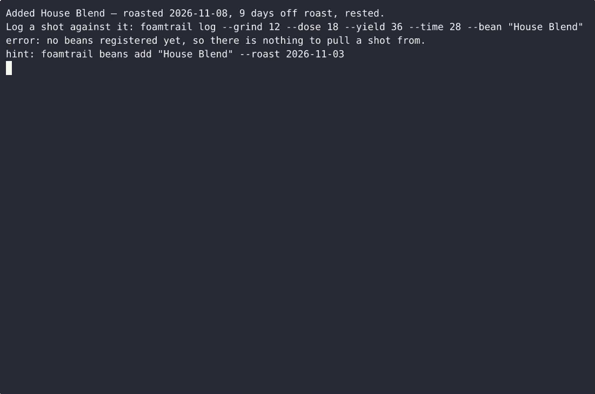
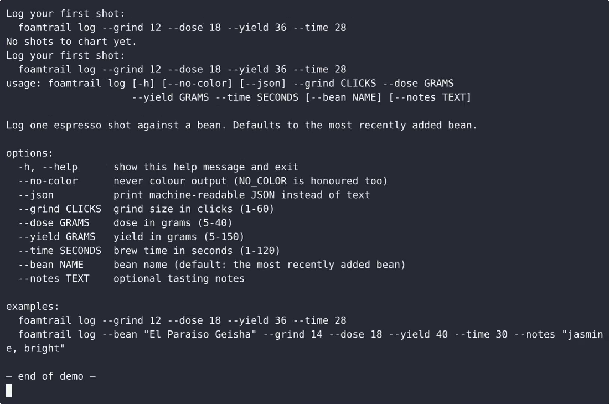

# FoamTrail — complete Full-stack app command-line tool example app

Clone it. Run it. Own it. **FoamTrail** is a complete, Apache-2.0-licensed command-line tool in Full-stack app — full source, demo data included. FoamTrail is a single-file, standard-library-only Python CLI for espresso dial-in: it logs each shot (bean, grind clicks, dose, yield, shot time, rating), renders an ASCII grind-size-versus-yield chart from the shots…. Self-host FoamTrail on your own infrastructure, or open it on [cenius.ai](https://cenius.ai/marketplace/p/foamtrail?ref=gh&utm_campaign=foamtrail-webapp) to request changes and get a FoamTrail fresh build.


[](LICENSE)  [](https://cenius.ai)

[](https://cenius.ai/marketplace/p/foamtrail?ref=gh&utm_campaign=foamtrail-webapp)

> **▶ [Open & edit in cenius.ai](https://cenius.ai/marketplace/p/foamtrail?ref=gh&utm_campaign=foamtrail-webapp)** — one click to an editable workspace: describe changes in plain English, get an instant preview, one-click deploy and host. Modifications made on the platform come with full rebrand & relicense rights.

_Local clone? See [Quick start](#quick-start) below. cenius.ai is the zero-setup path._

## Demo


📽 **[Demo video on cenius.ai](https://cenius.ai/marketplace/p/foamtrail?ref=gh&utm_campaign=foamtrail-webapp)** — the complete run-through · [MP4](.github/media/demo.mp4)

## Screenshots

 

## Features

- Espresso shot dial-in log
- Grind size versus yield chart
- Bean roast date freshness tracker

## Quick start

```bash
./install.sh   # installs dependencies + seeds demo data
```

See [`INSTALL.md`](INSTALL.md) for full setup and usage instructions.

## Architecture

A self-contained Full-stack app project (23 files): top-level directories include `tests/`. The setup script (`install.sh`) installs runtime dependencies and loads a starter dataset so the app is immediately usable. For environment-specific setup, see [`INSTALL.md`](INSTALL.md).

## Usage guide

A walkthrough of a real dial-in session. Commands are shown as
`python3 foamtrail.py …` so they work with no install; if `install.sh` put the
console script on your PATH, `foamtrail …` is the same thing.

### 1. Register the bag

Freshness is the first thing that decides whether a shot can taste good, so a
bag is always registered with its roast date (printed on the bag, often as
"roasted on"):

```console
$ python3 foamtrail.py beans add "House Blend" --roast 2026-11-08
Added House Blend — roasted 2026-11-08, 9 days off roast, rested.
Log a shot against it: foamtrail log --grind 12 --dose 18 --yield 36 --time 28 --bean "House Blend"
```

A roast date in the future, or one that does not parse, is refused and nothing
is written:

```console
$ python3 foamtrail.py beans add "Mystery" --roast 2024-13-40
error: roast date must look like YYYY-MM-DD (got '2024-13-40').
hint: for example: --roast 2025-06-28
```

### 2. See every bag and how stale it is

```console
$ python3 foamtrail.py beans
BEAN                 ROASTED     OFF ROAST  BAND    SHOTS
─────────────────────────────────────────────────────────
Huehuetenango Decaf  2026-11-15        2 d  fresh       0
House Blend          2026-11-08        9 d  rested      0
El Paraiso Geisha    2026-10-02       46 d  stale       0

fresh ≤ 7 days · rested 8–30 days · stale past 30 days off roast
```

The band is a text label, not just a colour, so it survives pipes and
`NO_COLOR`. With no beans registered you get an invitation instead of an empty
table:

_Full guide: [`USAGE.md`](USAGE.md)_

## FAQ

### How do I self-host FoamTrail?

Pull the repo, run `./install.sh`, and you are up — the script installs packages and pre-seeds the database. [`INSTALL.md`](INSTALL.md) covers any platform-specific tweaks.

### What license does FoamTrail use?

Confirmed free for commercial use — MIT terms let you incorporate, resell, or ship it in any product. [LICENSE](LICENSE).

### How do I customise FoamTrail's branding?

Rebranding is straightforward under the MIT license — change what you want in the source. Or [open it on cenius.ai](https://cenius.ai/marketplace/p/foamtrail?ref=gh&utm_campaign=foamtrail-webapp): the platform handles the changes and grants full rebrand rights on the result.

### How can I customize FoamTrail without editing code?

[cenius.ai](https://cenius.ai/marketplace/p/foamtrail?ref=gh&utm_campaign=foamtrail-webapp) handles the implementation. Tell it what you want in everyday words, pick up the updated build. No coding needed.

### What powers FoamTrail under the hood?

The app is built with Full-stack app. What you see in this repo is the full production source, demo data included. Highlights include espresso shot dial-in log.

## License & rebranding

Released under the [Apache License 2.0](LICENSE) (© 2026 Cenius AI) — free for personal and commercial use. The Cenius name/logo are trademarks (see NOTICE).

**Need a customized version?** [Remix this app on cenius.ai](https://cenius.ai/marketplace/p/foamtrail?ref=gh&utm_campaign=foamtrail-webapp) — modifications made on the platform come with **full rebrand & relicense rights** over your derivative.

## Built with cenius.ai

This entire application — code, design, seeded demo data — was generated on **[cenius.ai](https://cenius.ai)** from a plain-English description.

- 🚀 [Build your own app on cenius.ai](https://cenius.ai)
- 🎛️ [Remix FoamTrail on the marketplace](https://cenius.ai/marketplace/p/foamtrail?ref=gh&utm_campaign=foamtrail-webapp) — open it in a workspace, prompt for changes, and ship your own version.

More open-source apps: [the Cenius-ai catalog](https://github.com/Cenius-ai) · [showcase index](https://github.com/Cenius-ai/showcase)
